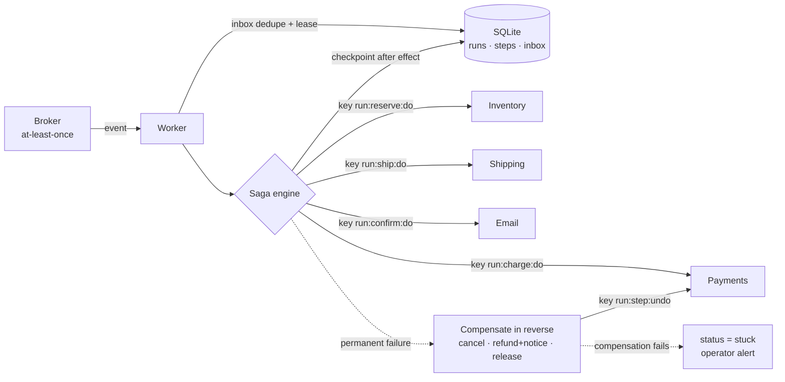

# agent-sagas

An agent workflow engine with durable checkpoints, the saga pattern with compensating actions, and idempotency keys for exactly-once external side effects. Fault-injection tests (crash mid-step, duplicate delivery, partial failure) show no duplicate charges or emails in mock payment and email services. A naive baseline under the same faults shows the duplicates.

## What it is
An agent that takes real-world actions (reserve stock → charge a card → create a shipment → email the customer) is a distributed transaction across services that it does not control. This engine runs such a workflow as a **saga**:
- each step's result is **checkpointed** to SQLite after the effect lands;
- each external call carries a deterministic **idempotency key** (`run_id:step:phase`);
- a permanent failure runs **compensations** in reverse order (cancel shipment → refund + refund notice → release stock);
- a **lease** stops two workers from driving the same run at the same time;
- inbound events are **deduplicated** by event id and mapped to a deterministic run id.

## Why
Agents retry. Brokers redeliver. Processes die after the payment API charged the card but before the agent saw the response. Without idempotency keys, the restarted agent charges again. Without checkpoints, it starts from zero. Without compensations, a failure halfway leaves money taken and nothing shipped.

## Architecture


## How it works
| Part | File | Behaviour |
|---|---|---|
| Store | [`sagas/store.py`](sagas/store.py) | SQLite (WAL) tables `runs`, `steps`, `inbox`. Atomic lease via conditional `UPDATE`. |
| Engine | [`sagas/engine.py`](sagas/engine.py) | Skips steps already marked `done`. Retries `TransientError` with exponential backoff. `StepFailed` → `compensating` (persisted, so a crash during compensation resumes compensation). A failed compensation → `stuck`, never silent. A simulated `Crash` (a `BaseException`) runs no cleanup, so its lease must expire, as with a real dead process. |
| Services | [`sagas/services.py`](sagas/services.py) | Stripe-style idempotent mocks. A repeated key returns the stored response with no new effect. Fault queue per operation: `transient`, `permanent`, `crash_before` (request never landed), `crash_after` (effect applied, response lost). |
| Example saga | [`sagas/order.py`](sagas/order.py) | reserve → charge → ship → confirm, with release / refund + notice / cancel as compensations. |

## Results
### Fault-injection campaign — measured
Run: `python3 eval/run_faults.py`. Raw output: [`results/fault_campaign.json`](results/fault_campaign.json). 500 orders, seed 42. Each order gets one random fault on one random operation (including compensations). 20% of orders have an invalid address, which forces the compensation path. The broker redelivers to a freshly restarted worker until the run is terminal. Both arms see the same faults; the baseline uses a fresh random key per attempt.

| Metric | Saga engine | Naive baseline |
|---|---|---|
| Faults injected | crash_after 84 · crash_before 78 · duplicate delivery 87 · transient 93 · transient ×5 77 · none 81 | same |
| Outcomes | 357 completed · 137 compensated · 6 stuck | same |
| **Duplicate charges** | **0** | 11 |
| **Duplicate confirmation emails** | **0** | 16 |
| Duplicate refund notices | 0 | 0 |
| Wrong net charge (non-stuck orders) | **0** | 14 |
| Orphan stock reservations (non-stuck orders) | **0** | 13 |
| Stuck runs flagged for an operator | 6 | 6 |

The 6 stuck runs got 5 transient errors on a compensation (`refund` or `release`), which exceeds `max_retries=3`. The engine stops and flags them instead of guessing. In those 6 runs, 2 still hold a charge and 6 still hold a reservation until an operator acts. A compensation that cannot finish is a real limit of sagas, and this result shows it.

### Tests
19 tests, all passing (`python3 -m pytest -q`; summary in [`results/test_summary.txt`](results/test_summary.txt)):
- happy path;
- crash after effect / before checkpoint, run for each of the 4 forward operations (exactly one charge, shipment and email after restart);
- naive baseline double-charges under the same crash;
- crash before effect;
- transient retries;
- retries exhausted → compensation;
- partial failure (shipping rejected) → refund + release + one refund notice;
- first step fails, nothing to undo;
- crash during compensation (refund applied once);
- duplicate delivery;
- concurrent duplicate delivery from two threads (lease → one charge);
- lease blocks until expiry after a crash;
- durable checkpoints read from a new connection;
- compensation failure → `stuck`;
- 40-order randomised fault test;
- eval gate.

## Run it
```bash
pip install pytest
python3 -m pytest -q
python3 eval/run_faults.py
```

## Limits
- All services are in-process mocks. Real providers differ: key retention windows (Stripe keeps keys about 24 h), and some email APIs have no idempotency keys at all, which needs an outbox pattern on your side.
- One SQLite file is the coordination point. Leases use wall-clock TTLs; there is no fencing token, so a paused worker that wakes after its lease expired could still write. Use fencing or a real workflow engine (Temporal, Restate, DBOS) in production.
- Crashes are simulated with an exception inside one Python process, not by killing an OS process.
- Compensation is "semantic undo". The customer still sees a charge and a refund. Some effects (a sent email) cannot be undone at all, which is why email is the last step.
- The campaign uses one seed and one saga shape. The numbers prove the mechanism on this workload; they are not a general reliability rate.

## Stack
Python 3.12 · stdlib (`sqlite3`, `threading`) · pytest

## License
MIT
